<p align="center">
  
</p>

<p align="center">
  
</p>

<p align="center">
  <a href="https://www.linkedin.com/in/amrjallad/">
    
  </a>
  &nbsp;
  <a href="https://github.com/loliamro?tab=repositories">
    
  </a>
</p>


### About

I'm a senior Computer Engineering student at **Abu Dhabi University**, concentrating in **Artificial Intelligence**. I'm passionate about using AI and engineering to improve healthcare: **biomedical and medical applications**, with a research focus on **cancer**. I like building systems that sit between hardware and intelligence: wearables that monitor patients, signal-processing pipelines that make sense of the body's signals, and models that help detect problems earlier.

Outside the lab I spend a lot of time building student tech communities: leading the IEEE ADU Student Branch, advising GDG on Campus, and running Python sessions for the Cybersecurity Club.

```text
location   Abu Dhabi, UAE
studying   B.Sc. Computer Engineering (AI), Abu Dhabi University, 2027
research   AI for biomedical & medical applications, cancer research
focus      machine learning / IoT / embedded systems / signal processing
currently  publishing research and leading IEEE ADU
```


### Research Papers

<table>
  <tr>
    <td valign="top">
      <a href="https://www.researchgate.net/publication/407328286_GuardBand_AI_A_Wearable_Edge-Computing_System_for_Real-Time_Fall_Detection_and_Behavioral_Anomaly_Monitoring_in_Elderly_Patients"><b>GuardBand AI: A Wearable Edge-Computing System for Real-Time Fall Detection and Behavioral Anomaly Monitoring in Elderly Patients</b></a>
      <p>A wrist-worn edge-AI system that detects falls and unusual behavior in elderly patients in real time.</p>
      <code>Wearables</code> <code>Edge AI</code> <code>Healthcare</code> &nbsp; <a href="https://github.com/loliamro/guardband-ai-fall-detection">Code</a>
    </td>
  </tr>
  <tr>
    <td valign="top">
      <a href="https://www.researchgate.net/publication/407325981_AI-Powered_Neuroadaptive_Interfaces_Using_Wearable_EEG-Based_Brain-Computer_Interfaces_for_Structural_UI_Adaptation"><b>AI-Powered Neuroadaptive Interfaces Using Wearable EEG-Based Brain-Computer Interfaces for Structural UI Adaptation</b></a>
      <p>Using wearable EEG brain-computer interfaces and AI to adapt user interfaces to the user's brain signals.</p>
      <code>EEG</code> <code>BCI</code> <code>AI</code>
    </td>
  </tr>
</table>

<p>
  <a href="https://www.researchgate.net/publication/407328286_GuardBand_AI_A_Wearable_Edge-Computing_System_for_Real-Time_Fall_Detection_and_Behavioral_Anomaly_Monitoring_in_Elderly_Patients"></a>
  <a href="https://www.researchgate.net/publication/407325981_AI-Powered_Neuroadaptive_Interfaces_Using_Wearable_EEG-Based_Brain-Computer_Interfaces_for_Structural_UI_Adaptation"></a>
</p>


### Leadership

| Role | Organization | Since |
|:--|:--|:--|
| **Chair** | IEEE Abu Dhabi University Student Branch | 2026 |
| **Senior Advisor** (previously Co-Lead and AI Lead) | Google Developer Groups on Campus, ADU | 2024 |
| **Under-Secretary-General of Design** | ADU Model United Nations | 2025 |
| **Python Community Lead** | ADU Cybersecurity Club | 2023 |
| **Marketing Coordinator Lead** | ADU Student Council, 2025 to 2026 | 2025 |

**Competition Winner**, Smart Vacuum Robot (CEN425 IoT), Abu Dhabi University

**Outstanding Volunteer Award**, Abu Dhabi University Student Council, 2024


### Tech Stack

<p align="center">
  
</p>

<p align="center">
  
  
  
  
  
  
</p>


### Featured Projects

<table>
  <tr>
    <td width="50%" valign="top">
      <a href="https://github.com/loliamro/Smart-Vacuum-Robot"><b>Smart Vacuum Robot</b></a> 
      <p>Autonomous Raspberry Pi 4 robot with gyro-guided turns, ultrasonic wall detection, OpenCV motion detection, a live web dashboard and Telegram alerts.</p>
      <code>Raspberry Pi</code> <code>Python</code> <code>OpenCV</code> <code>IoT</code>
    </td>
    <td width="50%" valign="top">
      <a href="https://github.com/loliamro/guardband-ai-fall-detection"><b>GuardBand: AI Fall Detection</b></a>
      <p>Wrist-worn IoT device that detects falls and flags unusual motion with AI, streaming live to a Python dashboard. Published as a research paper.</p>
      <code>ESP32</code> <code>MPU6050</code> <code>C++</code> <code>Python</code>
    </td>
  </tr>
  <tr>
    <td width="50%" valign="top">
      <a href="https://github.com/loliamro/AI-Cabin-Condition-Monitor"><b>AI Cabin Condition Monitor</b></a>
      <p>TinyML on an Arduino Nano 33 BLE Sense: a 6.4 KB CNN classifies the cabin as Normal, Caution or Alert with 99.8% test accuracy.</p>
      <code>TinyML</code> <code>TensorFlow Lite</code> <code>Arduino</code> <code>CNN</code>
    </td>
    <td width="50%" valign="top">
      <a href="https://github.com/loliamro/Bluetooth-Sumo-Robot"><b>Bluetooth Sumo Robot</b></a>
      <p>PS4-controlled sumo robot: ESP32 Bluetooth with Arduino tank steering over UART and a 3D-printed wedge. 15 m range, 130 ms latency.</p>
      <code>ESP32</code> <code>Arduino</code> <code>Bluetooth</code> <code>Fusion 360</code>
    </td>
  </tr>
  <tr>
    <td width="50%" valign="top">
      <a href="https://github.com/loliamro/Sound-Recognition-and-Visualization"><b>Sound Recognition &amp; Visualization</b></a>
      <p>MATLAB app that records audio and breaks it down: FFT, power spectrum, PSD, spectrogram and statistics, with a hand-built FIR noise filter.</p>
      <code>MATLAB</code> <code>DSP</code> <code>FIR filters</code>
    </td>
    <td width="50%" valign="top">
      <a href="https://github.com/loliamro/6V-Lead-Acid-Battery-Charger"><b>6 V Lead-Acid Battery Charger</b></a>
      <p>Discrete series-pass regulator with feedback and current limiting, taken from LTspice to a custom EasyEDA PCB. 0.73% voltage regulation.</p>
      <code>LTspice</code> <code>EasyEDA</code> <code>Analog</code> <code>PCB</code>
    </td>
  </tr>
  <tr>
    <td width="50%" valign="top">
      <a href="https://github.com/loliamro/CPU-Scheduling-Fairness-Simulator"><b>CPU Scheduling Fairness Simulator</b></a>
      <p>C simulator comparing FCFS, SJF, Round Robin, Priority, CFS and Lottery scheduling across 4 workloads, measuring speed and Jain's fairness.</p>
      <code>C</code> <code>Operating Systems</code> <code>Make</code>
    </td>
    <td width="50%" valign="top">
      <a href="https://github.com/loliamro/RC-High-Pass-Filter"><b>RC High-Pass Filter</b></a>
      <p>First-order RC filter with a ~15.9 kHz cutoff: Multisim simulation, Bode plot and breadboard measurements.</p>
      <code>Multisim</code> <code>Circuits</code> <code>Oscilloscope</code>
    </td>
  </tr>
  <tr>
    <td width="50%" valign="top">
      <a href="https://github.com/loliamro/Predict-The-2025-F1-World-Champion-Using-Python-Pandas-Seaborn"><b>F1 2025 Champion Predictor</b></a>
      <p>Projects every driver's final points from their per-race average and visualizes the predicted standings.</p>
      <code>Python</code> <code>Pandas</code> <code>Seaborn</code>
    </td>
    <td width="50%" valign="top">
      <a href="https://github.com/loliamro/Linear-Regression"><b>Student Grade Predictor</b></a>
      <p>Linear regression model that predicts final grades from earlier grades, study time, failures and absences.</p>
      <code>scikit-learn</code> <code>NumPy</code> <code>Tkinter</code>
    </td>
  </tr>
</table>


### Certifications

<p>
  
  
  
  
  
  
  
</p>


### GitHub Activity

<p align="center">
  
  
</p>

<p align="center">
  
</p>

<p align="center">
  <picture>
    <source media="(prefers-color-scheme: dark)" srcset="https://raw.githubusercontent.com/loliamro/loliamro/output/github-snake-dark.svg" />
    <source media="(prefers-color-scheme: light)" srcset="https://raw.githubusercontent.com/loliamro/loliamro/output/github-snake.svg" />
    
  </picture>
</p>


<p align="center">
  
</p>

<p align="center">
  <sub>Always happy to connect. The fastest way to reach me is <a href="https://www.linkedin.com/in/amrjallad/">LinkedIn</a>.</sub>
</p>
